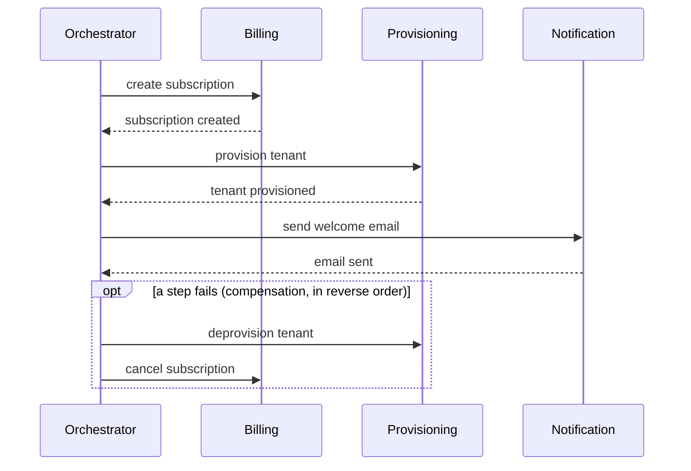

# SaaS Onboarding SAGA

University exam project: onboarding a customer to a SaaS product with an orchestrated SAGA across .NET microservices.

When a subscription is created, the orchestrator runs three steps: Billing creates the subscription, Provisioning sets up the tenant, and Notification sends the welcome email. If a step fails, the steps already done are compensated: the tenant is deprovisioned and the subscription cancelled.

## Quick Start

1. Run the containers:

   ```
   cd docker
   docker compose up -d
   ```

   > All databases, tables, and Kafka topics are created automatically. The SQL Server password in `docker-compose.yml` is a local demo value.

2. Access the APIs via Swagger:
   - Orchestrator: http://localhost:5013/swagger
   - Billing: http://localhost:5037/swagger
   - Provisioning: http://localhost:5148/swagger
   - Notification: http://localhost:5214/swagger

## Try it

Start a SAGA (a new subscription for a customer):

```bash
curl -s -X POST http://localhost:5013/api/Sagas/subscription \
  -H "Content-Type: application/json" \
  -d '{"customerId": "3fa85f64-5717-4562-b3fc-2c963f66afa6", "planId": "pro", "tenantName": "acme"}'
```

The response contains the `sagaId`. Follow its progress (it completes in about 30 seconds, see the notes below):

```bash
curl -s http://localhost:5013/api/Sagas/<sagaId>
```

To see the rollback, trigger the compensation manually: the tenant is deprovisioned and the subscription cancelled.

```bash
curl -s -X POST http://localhost:5013/api/Sagas/<sagaId>/compensate
```

## Architecture



- **BillingService**: Manages subscription creation and cancellation.
- **ProvisioningService**: Handles tenant creation and deprovisioning.
- **NotificationService**: Sends welcome emails and notifications.
- **Orchestrator**: Coordinates the SAGA and manages compensation logic.
- **Kafka**: Asynchronous event management between services.
- **SQL Server**: Dedicated database for each microservice.

## Main Features

- SAGA pattern with forward and compensating transactions
- Synchronous (HTTP) and asynchronous (Kafka) communication
- Entity Framework Core for data access, with the schema created by SQL scripts at startup
- Full automation via Docker Compose
- CI/CD and Docker images published on GHCR

## Docker Images
- **saas-orchestrator**: Coordinates the SAGA workflow, manages distributed transactions, and handles compensation logic between services.
- **saas-billing**: Manages subscription creation, billing operations, and compensation (cancellation) in case of failures.
- **saas-provisioning**: Handles tenant/resource provisioning, implements retry logic for transient errors, and supports deprovisioning for rollback.
- **saas-notification**: Simulates sending welcome emails and notifications, logs actions for traceability, and emits events for other services.
- **kafka-init**: Initializes Kafka topics required for the SAGA workflow, ensuring all event channels are available before services start.
- **sql-init**: Creates all required databases and runs the SQL scripts in `sql/`, so all microservices have their schema ready at startup.

## Additional notes

- The NotificationService does not send real emails: sending is simulated and logged in the database for traceability. No SMTP or external provider is used.
- The SAGA workflow takes about 30 seconds to complete because the ProvisioningService implements retry logic with exponential backoff and artificial delays to simulate real-world cloud provisioning and transient failures. This is intentional to demonstrate the reliability and compensation mechanisms of the SAGA pattern.
- Every service uses the transactional outbox pattern: events are saved in the service's database together with the data, and a background service publishes them to Kafka, ensuring reliable event delivery and eventual consistency.
- All external integrations (cloud APIs, email, etc.) are simulated for demonstration and testing purposes; no real resources are created or modified.
